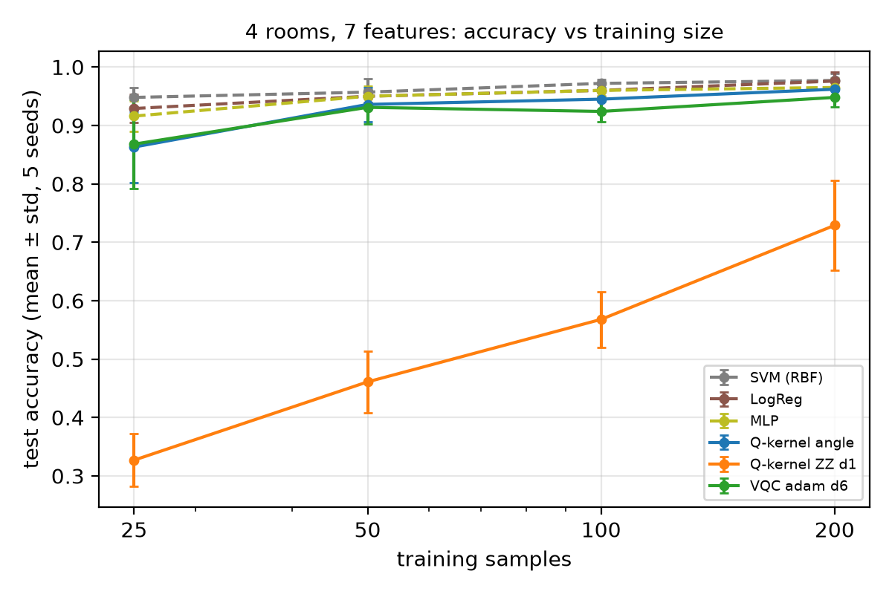
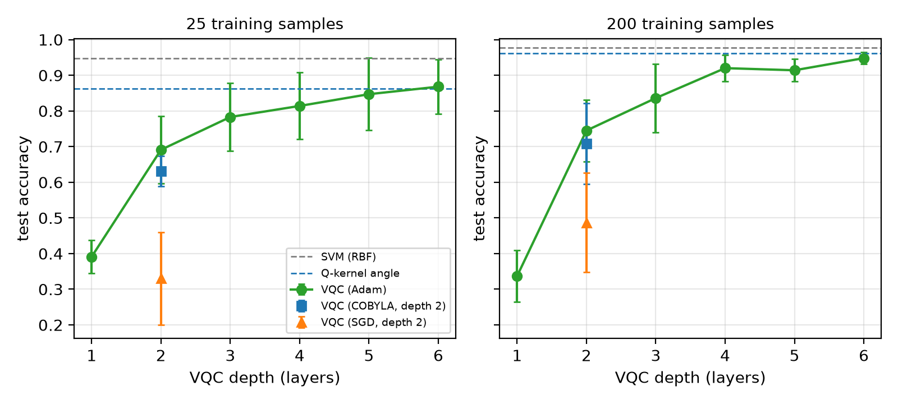
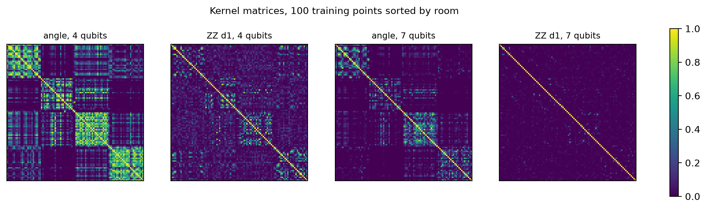
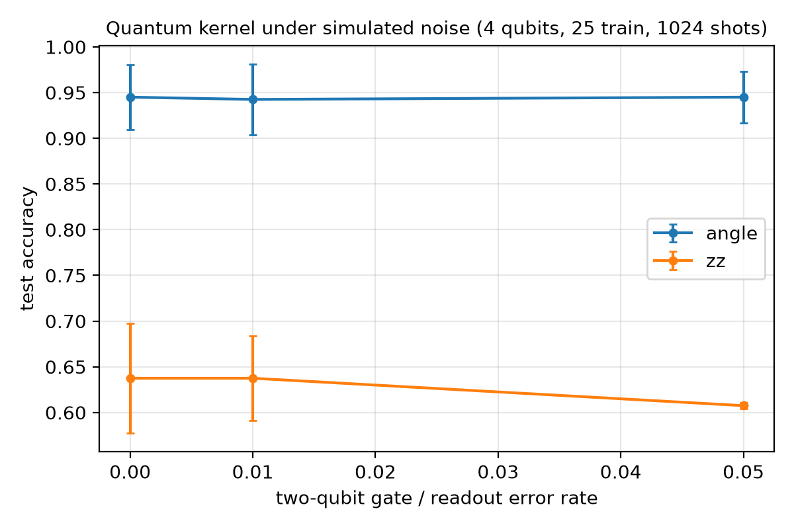

---
Quantum vs classical indoor localization from WiFi signals
Q//Horizon 2026 — Team report
Team Hello qubit!
Members: Jana Fawzi, Yasmine Mohamed, Jana Salama, Janna Alfiky
---

## 1. Question and data

**Question.** Can a quantum classifier tell which room a phone is in from WiFi signal strengths, and when is that worth it compared with classical models?

**Data.** UCI *Wireless Indoor Localization* (Bhatt, 2017): 2000 samples, 7 WiFi signal strengths, 4 rooms with 500 samples each (chance level is 25%). We chose it because the task is easy to explain, has 7 features (one qubit per feature) and is small enough to simulate, and because it is a telecom-style problem.

## 2. Approach

**Fair comparison.** All models read the same frozen splits (`data/splits/`): 5 seeds (0–4), training sizes 25/50/100/200, and a fixed 200-sample stratified test set per seed. Features are selected by ANOVA F-score and scaled to $[0,\pi]$ using training data only. We report accuracy and macro-F1 (mean ± std over 5 seeds) and training time.

**Classical baselines.** SVM with RBF kernel, logistic regression and a small neural net (MLP). Each is tuned by 3-fold cross-validation on the *training set only* (SVM: C and gamma; logistic regression: C; MLP: hidden layer sizes), never on test data.

**Quantum kernel + SVM.** Each sample is encoded into a quantum state, and the kernel $K(x,x')=|\langle\psi(x)|\psi(x')\rangle|^2$ is passed to a standard SVM. We compare two encodings: *angle* (one rotation per qubit, no entanglement) and the *ZZ feature map* (adds entangling gates; depth 1 and 2), on 4–7 qubits. Kernels are computed exactly with a statevector simulator. We chose these two because they differ in one thing only: entanglement.

**Variational quantum classifier (VQC).** Same angle encoding as the kernel (one rotation per feature, 7 qubits), so VQC vs kernel compares the model and not the encoding. The trainable part is a standard `StronglyEntanglingLayers` circuit (rotations on every qubit plus a ring of CNOTs). The first two qubits are measured to give the 4 room probabilities, trained with cross-entropy loss, 60 steps, learning rate 0.1. We ran depth 1 to 6 with the Adam optimizer, and at depth 2 also plain gradient descent and COBYLA (gradient-free). All of them are reported; we do not pick a "best" depth using test accuracy.

**Noise.** To test hardware-like conditions we estimated each kernel entry by sampling (1024 shots) on a noisy simulator with depolarizing gate errors and readout errors, sweeping the two-qubit error from 0 to 5% (4 qubits, 25 training samples, 3 seeds).

## 3. Results

{width=52%}

| Model (4 rooms, 7 features) | 100 train | 200 train |
|---|---|---|
| SVM (RBF) | 0.972 ± 0.007 | 0.977 ± 0.012 |
| Logistic regression | 0.960 ± 0.011 | 0.976 ± 0.016 |
| MLP | 0.960 ± 0.009 | 0.965 ± 0.017 |
| Q-kernel, angle encoding | 0.945 ± 0.020 | 0.962 ± 0.013 |
| Q-kernel, ZZ feature map (depth 1) | 0.568 ± 0.048 | 0.729 ± 0.077 |
| VQC, depth 6 (deepest tested) | 0.924 ± 0.018 | 0.948 ± 0.017 |
| VQC, depth 2 | 0.742 ± 0.102 | 0.745 ± 0.087 |
| VQC, depth 1 | 0.390 ± 0.068 | 0.337 ± 0.073 |

Mean ± std over 5 seeds, 200 test samples each; chance is 0.25. All other VQC depths and optimizers are in `results/summary_headline.csv` and Figure 2.

**The classical models win.** Paired by seed (same split) at 200 training samples, the angle kernel is 1.5 points below the SVM (±0.8, worse on all 5 seeds), VQC depth 6 is 2.9 points below (±1.8, worse on all 5 seeds) and the ZZ kernel is 24.8 points below. With only 25 training samples the angle kernel and VQC depth 6 (both about 0.87) are further behind the classical models (0.91 to 0.95). On the easier 4-qubit version the angle kernel is within 0.6 points of the SVM (one seed in five better), which is within noise.

## 4. Why the ZZ kernel fails here

Figure 3 shows the kernel matrices for 100 training points sorted by room. With angle encoding the matrix has clear blocks: points from the same room look similar. With the 7-qubit ZZ map almost every pair looks equally dissimilar (values near 0), so the SVM has nothing to separate. The spread of off-diagonal kernel values quantifies this: at 7 qubits and 200 samples it is 0.146 for angle and 0.034 for ZZ. This matches the known problem of *kernel concentration*, where highly expressive, entangling embeddings make kernel values nearly constant as qubits grow (Thanasilp et al., 2024). More qubits made ZZ worse (4 → 7 qubits: 88.4% → 72.9% at 200 samples).

{width=78%}

VQC accuracy rises steadily with depth and has not levelled off by depth 6, the deepest we tested, so deeper circuits might close more of the gap; we did not test that. Adam clearly beat plain gradient descent at depth 2 (0.745 vs 0.487 at 200 samples).

{width=88%}

## 5. Noise

{width=55%}

## 6. What we learned

1. More quantum structure was not better: the simplest encoding (no entanglement) beat the entangling one by about 23 points at 7 qubits.
2. On this problem the best quantum models come close to, but do not beat, the classical ones: angle kernel 96.2% and VQC depth 6 94.8% vs SVM 97.7% at 200 samples. The task is easy (7 features, 4 well separated rooms), so there was little room for a quantum advantage.
3. Cost: the 7-qubit simulated kernel took about 57 s to train at 200 samples, VQC depth 6 about 9 s, and the classical SVM 0.4 s. Kernel cost grows with the square of the training size.
4. Limits: simulator only; 200 test samples (one sample = 0.5 points); one dataset; the quantum-kernel SVM used a fixed C=1 while the classical models were tuned (a check on the 4-qubit task, `analysis/check_C_tuning.py`, showed that tuning C by cross-validation changed kernel accuracy by at most 1.2 points and not consistently upward); VQC depth was only tested up to 6 and only on the 7-feature task; the noise sweep covers a small setting.

## 7. AI tools, sources, who did what

**AI use.** We used Claude (Anthropic) to learn the basics, plan the project and draft scripts and report text. All numbers come from code in the repo.

**Sources.** See `SOURCES.md`: Bhatt (2017); Havlicek et al., *Nature* 567 (2019); Thanasilp et al., *Nat. Commun.* 15 (2024); Qiskit, scikit-learn.

**Who did what.** Jana Fawzi: data, splits, baselines, evaluation. Yasmine Mohamed: quantum kernel track. Jana Salama: VQC track. Janna Alfiky: plots, noise experiments, README, report. 
